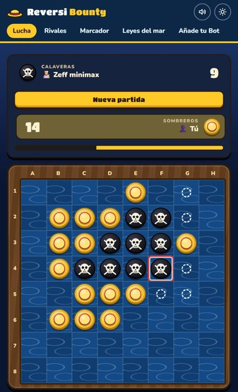

# Reversi Bounty

[](https://github.com/m3hervas/Reversi-Bounty/actions/workflows/tests.yml)
[](https://reversi-bounty.readthedocs.io)
[](https://m3hervas.github.io/Reversi-Bounty/)
[](LICENSE)

<p align="center">
  <a href="https://m3hervas.github.io/Reversi-Bounty/">
    
  </a>
</p>

<a href="https://m3hervas.github.io/Reversi-Bounty/#/jugar"></a>

**Reversi (Othello) para personas y bots.** En un tablero de 8×8, cada jugada encierra fichas
rivales en línea recta y les da la vuelta; gana quien acabe con más. Juegas contra bots de IA
escritos en Python, cada uno con su cartel de recompensa, y un torneo nocturno los clasifica a
todos. Las reglas y los bots se escriben una sola vez, en Python, y ese mismo código corre en los
tests, en el torneo y en tu navegador. Práctica de IA, CUNEF 2026/27.

- 🏆 **[Marcador del torneo](https://m3hervas.github.io/Reversi-Bounty/#/marcador)**: se juega cada noche.
- 📚 **[Documentación](https://reversi-bounty.readthedocs.io)**: [reglas](https://reversi-bounty.readthedocs.io/es/latest/reglas/),
  [los rivales](https://reversi-bounty.readthedocs.io/es/latest/rivales/), uso desde Python y API.

<br clear="right">

## Instalar y jugar

```bash
git clone https://github.com/m3hervas/Reversi-Bounty.git
cd Reversi-Bounty
python -m venv .venv
.venv\Scripts\activate         # Windows
source .venv/bin/activate      # Linux/macOS
pip install -e ".[dev]"

reversi-play          # dos personas en la terminal (también reversi-play-color)
reversi-tournament    # liguilla entre todos los bots
```

## Añadir tu bot

Una subclase de `Player` con nombre, autores, descripción, emoji y el método `choose_move`. Va en
`players/custom/`, con una línea en su `players.yaml`, y se envía por pull request: los tests
comprueban solos que juega legal. Sigue el
**[tutorial](https://reversi-bounty.readthedocs.io/es/latest/tutorial/)**.

## Licencia

[MIT](LICENSE): puedes usar, copiar y modificar el código manteniendo el aviso de copyright.
